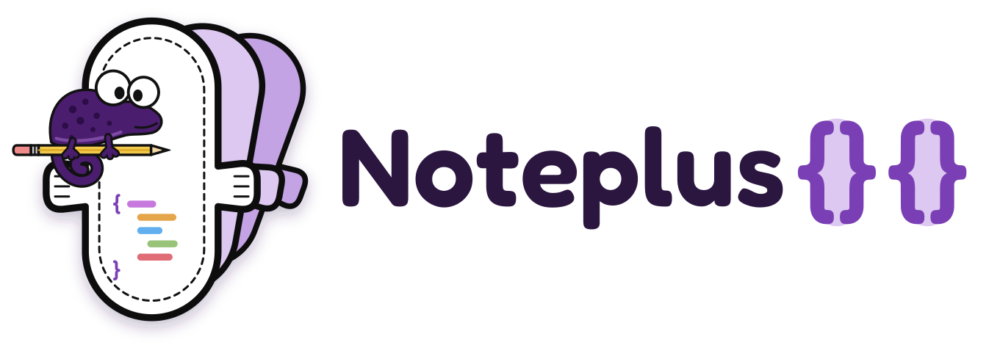
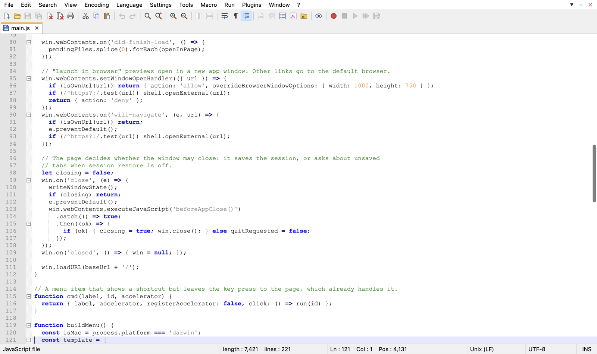

# NoteplusPP

NoteplusPP is a copy of Notepad++ for macOS. Notepad++ only runs on Windows, and its developers don't make a Mac version, so this app recreates it for the Mac. It has the same menus, toolbar, tabs and keyboard shortcuts as Notepad++. Its official name is Noteplus-PadPad, said "note plus pad pad".

NoteplusPP is an independent project. It is not affiliated with or endorsed by the Notepad++ project or its author.

## Download

Get the latest `.dmg` from the [Releases page](../../releases/latest).

| Your Mac | File |
| --- | --- |
| Apple silicon, M1 and later | `NoteplusPP-<version>-arm64.dmg` |
| Intel | `NoteplusPP-<version>-x64.dmg` |

To check which one you have, open the Apple menu, choose About This Mac, and look at the Chip or Processor line.

Open the `.dmg` and drag NoteplusPP into Applications.

### First launch

Apple has not notarized the app yet, so macOS blocks it the first time you open it. To allow it:

1. Double-click NoteplusPP in Applications. macOS says it can't verify the app. Click Done.
2. Open System Settings, then Privacy & Security.
3. Scroll to the Security section. Next to the message about NoteplusPP, click Open Anyway, then confirm.

You only do this once. If macOS instead says the app "is damaged", run this in Terminal and open it again:

    xattr -dr com.apple.quarantine /Applications/NoteplusPP.app

When you first open a file in Documents, Desktop or Downloads, macOS asks whether NoteplusPP may access that folder. Click Allow.

## Features

- Tabs, with unsaved text kept between launches.
- Syntax highlighting and code folding for 56 languages, plus word and function auto-completion.
- Find, Replace, Mark, and Find in Files across a folder, with regular expressions.
- Column mode, multi-cursor editing and the column editor.
- Line operations: sort, remove duplicates, join, split, move, trim.
- Bookmarks, a function list, a document list and a folder workspace panel.
- Macro recording and playback.
- Encoding conversion, and line-ending conversion between Windows, Unix and Mac formats.
- Dark mode, themes, and a shortcut mapper.

On macOS, Cmd works wherever Notepad++ uses Ctrl. Cmd+S saves, Cmd+F finds, Cmd+W closes the tab.

You can open files from Finder with Open With, by dropping them on the Dock icon, or by dropping them on the window. The app saves its session in `~/Library/Application Support/NoteplusPP`.

## Build from source

You need Node.js 22.12 or later.

    git clone https://github.com/marulecha/notepluspadpad.git
    cd notepluspadpad
    npm install

| Command | What it does |
| --- | --- |
| `npm run app` | Runs the desktop app from source. |
| `npm run dist` | Builds `.dmg` and `.zip` files for Apple silicon and Intel into `dist/`. |
| `npm start` | Runs the editor in your browser at http://localhost:7777 instead. |

In browser mode the server listens on 127.0.0.1 only, and session data goes to `data/session.json`. You can open a file directly with `http://localhost:7777/?open=/path/to/file&line=12`. The browser keeps Cmd+N, Cmd+W and Cmd+T for itself, so use Ctrl+N and Ctrl+W there.

### Releases

Pushing a version tag builds the app on GitHub Actions and attaches the files to a new release:

    git tag v1.0.0
    git push origin v1.0.0

The workflow signs builds ad hoc, without a developer identity. To ship a notarized build, which skips the first-launch steps above, add an Apple Developer ID certificate and set the notarization variables described in the [electron-builder docs](https://www.electron.build/code-signing-mac).

## Layout

- `electron/main.js` starts the server inside the app on a free local port and opens the window. It also builds the native menu and handles files opened from Finder.
- `electron/preload.js` gives the page the real path of files dropped from Finder.
- `server.js` serves the UI and the file API. The API reads, writes and lists files, runs find and replace across files, and stores the session.
- `public/js/` is the editor UI, built on CodeMirror 5.
- `build/brand/make.py` generates the artwork from `build/brand/mascot.svg` and the Fredoka font. `build/icon.svg` and `public/favicon.svg` are the app icon, `public/logo.svg` is the mark in the About dialog, and `public/logo-wordmark.svg` is the README header. `build/icon.png` is the 1024px render of `build/icon.svg`.

## License

NoteplusPP uses the MIT license. See [LICENSE](LICENSE). CodeMirror 5 also uses the MIT license.
